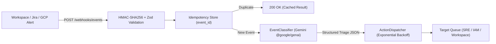

# Workspace AI Workflow Engine


An event-driven, **idempotent webhook & Generative AI workflow engine** built with **TypeScript**, **Node.js**, **Express**, and **Gemini (`@google/genai`)**, designed for **Google Cloud Run**.

It ingests enterprise events (Google Workspace, Jira, GCP Monitoring), validates HMAC signatures and schemas, prevents duplicate executions via idempotency keys, classifies/summarizes events with Gemini structured JSON output, and dispatches downstream actions with exponential backoff retries.

---

## Architecture



## Key Engineering Highlights

- **HMAC-SHA256 Webhook Verification (`src/services/security.ts`)**: Constant-time signature verification (`crypto.timingSafeEqual`) to prevent spoofed webhook calls.
- **Strict Idempotency (`src/services/idempotency.ts`)**: Replayed webhook deliveries with the same `event_id` return the original execution without re-invoking Gemini or duplicating side effects.
- **Resilient Dispatch (`src/services/retry.ts`)**: Exponential backoff retry helper for transient downstream failures (`503` / timeouts).
- **Gemini Structured Output (`src/services/classifier.ts`)**: Uses the official `@google/genai` SDK with `responseSchema` + Zod validation, plus a zero-key local classifier for instant demos and CI.
- **Multi-Stage Docker Build**: Minimal production runtime image running as non-root `node` user for Cloud Run.

---

## Quickstart

```bash
git clone https://github.com/matheuswow/workspace-ai-workflow-engine.git
cd workspace-ai-workflow-engine
npm install
npm run dev
```

### Example Webhook Request

```bash
curl -X POST http://localhost:8080/webhooks/events \
  -H "Content-Type: application/json" \
  -d '{
    "event_id": "evt-1001",
    "source": "gcp-monitoring",
    "title": "Production outage on Cloud Run billing API",
    "body": "500 error spike detected across southamerica-east1.",
    "requester": "alert-bot"
  }'
```

Send the exact same request a second time to see `"duplicate": true` returned without re-dispatching.

---

## Scripts

```bash
npm run typecheck
npm test
npm run build
```
